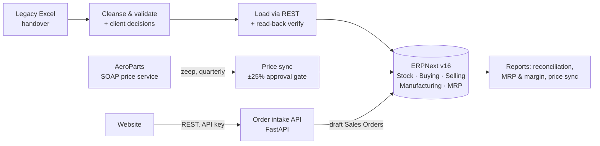

# ERPNext Implementation: SkyForge Drones (Manufacturing SME)

An end-to-end ERP implementation for a simulated drone manufacturer, delivered the way a client
engagement runs: **requirements → configuration → data migration → business process rollout →
integrations → UAT → cutover → hypercare**. Built on ERPNext v16, with every step scripted and
reproducible from an empty system.

> SkyForge Drones is a fictional client. Company names, GSTINs and contacts are invented.

## Results at a glance

| | |
|---|---|
| **Data migration** | 81 data-quality exceptions in the client's Excel handover, each resolved and logged (64 auto-fixed, 16 client decisions, 1 accepted); **19/19** post-load verification checks read back from ERPNext |
| **Planning (MRP)** | 3 sales orders → multi-level BOM explosion → only **2 of 23** components needed buying (ESC-30A ×14, GPS-M10 ×4), matching a hand calculation |
| **Business cycle** | Full Procure-to-Pay and Order-to-Cash on **₹9.7 lakh** of orders; 9 work orders; actual cost = BOM cost to the rupee |
| **Costing insight** | Quantified the margin gap the client suspected: SF-Q250 **39.1%** vs SF-X450 **31.4%** |
| **Integrations** | Supplier **SOAP** price sync with approval controls (held a +47% quote); **REST** order-intake API, idempotent and validated |
| **Quality** | **60 automated tests**: 46 unit + 14 live UAT cases (incl. negative and role-permission tests) |
| **Cutover** | One-command rebuild (`run_all.sh --fresh`) rehearsed as a mock cutover; post-go-live migration lock |

## The client problem

SkyForge assembles two drone models from ~20 purchased components. Stock lives in Excel, purchasing
happens on WhatsApp, and product cost is updated once a year. Stock-outs of imported parts delayed 11
orders last quarter. → [Requirements & fit-gap analysis](docs/01_requirements.md)

## Architecture



## Deliverables

| # | Phase | Deliverable |
|---|---|---|
| 1 | Requirements | [Requirements & fit-gap analysis](docs/01_requirements.md): 13 requirements, 9 fit/config, 3 gaps, 1 out of scope |
| 2 | Configuration | [Config-as-code](config/configure.py): company, FY, warehouses, module controls (PO-required, SO-required, no negative stock, auto-reorder), role-based users |
| 3 | Business process | [First month of operations](docs/03_business_cycle_results.md): MRP, P2P, manufacturing, O2C, margins, reorder automation ([script](scenarios/business_cycle.py)) |
| 4 | Data migration | [Reconciliation report](docs/04_migration_reconciliation.md) · [exception log](docs/04_migration_exception_log.csv) · [client decisions](migration/decisions.json) · [pipeline](migration/) |
| 5 | Integration | [Price sync report](docs/05_price_sync_report.md) · [SOAP service](integration/supplier_soap_service.py) · [sync job](integration/price_sync.py) · [order intake API](integration/order_intake_api.py) |
| 6 | Testing & cutover | [UAT scripts & results](docs/06_uat_test_scripts.md) (14/14 pass) · [cutover plan](docs/06_cutover_plan.md) |
| 7 | Hypercare | [Issue log](docs/07_issue_log.md) (14 issues) · [client status report](docs/07_status_report.md) · [purchase user guide](docs/07_user_guide_purchase.md) |
| 8 | Demo | [Walkthrough script](docs/08_demo_script.md) |

## Selected lessons (from the [issue log](docs/07_issue_log.md))

- **The UI does work the API skips.** Sales orders created via REST came in at ₹0 because price lookup
  runs in the browser. Integrations must price server-side.
- **Read the field, not the label.** In v16, `ignore_existing_ordered_qty` means *"consider projected
  qty"*. Left off, MRP proposed 42 purchase lines instead of 2. Caught by checking MRP against a hand
  calculation.
- **Auto-fix only what has one right answer.** Title-casing "GREENACRE" mangled a brand name. Names now
  go to the client.
- **Protect live data from your own tools.** A migration re-run after go-live overwrote synced prices,
  so the loader now refuses to run on a live system.

## Run it yourself

Requirements: Docker with the compose plugin, Python 3.10+, ~4 GB RAM.

```bash
python3 -m venv .venv && .venv/bin/pip install -r requirements.txt
./run_all.sh --fresh        # ~3 min (+ one-time ~2 GB image pull): empty ERPNext → configured, migrated, operated, integrated, tested
# ERPNext UI: http://localhost:8080  (Administrator / admin)
# Department users: stores@, purchase@, production@, sales@skyforge.example / SkyForge@2026
```

Individual steps:

```bash
.venv/bin/python -m config.configure                 # Phase 2 (idempotent)
.venv/bin/python -m migration.run --dry-run --no-decisions   # first-pass exceptions
.venv/bin/python -m migration.run                    # Phase 4 load + verify
.venv/bin/python -m scenarios.business_cycle         # Phase 3
.venv/bin/python -m integration.supplier_soap_service &   .venv/bin/python -m integration.price_sync
.venv/bin/uvicorn integration.order_intake_api:app --port 8090   # docs at /docs
.venv/bin/python -m pytest -q                        # live tests skip if ERPNext is down
```

## Repository layout

```
config/       ERPNext configuration as code
migration/    cleanse → load → verify pipeline, client decisions
scenarios/    end-to-end business cycle + results report
integration/  supplier SOAP service, price sync job, order intake REST API
erp/          thin ERPNext REST client
tests/        unit tests + live UAT tests
docs/         consulting deliverables (01–08)
data/legacy/  client's legacy Excel handover (generated by tools/generate_legacy_data.py)
infra/        docker-compose for the ERPNext sandbox
```

**Stack:** ERPNext / Frappe v16 · MariaDB · Python (pandas, requests, zeep, FastAPI, pydantic, pytest) · Docker
